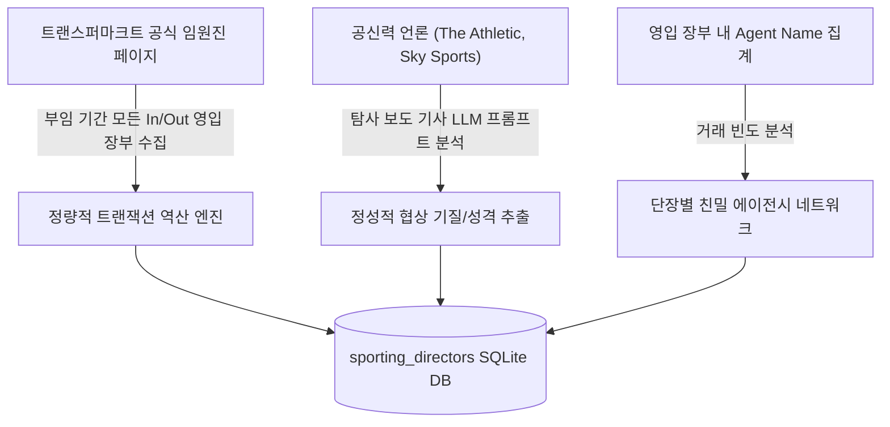
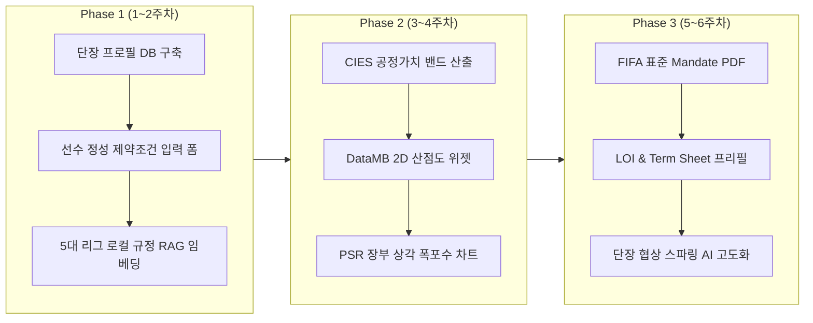

# 📋 [기획서] AgencyOS Pro 실무 고도화 및 정량 데이터 확장 방안
**AgencyOS Pro Practical Operations & Empirical Data Enhancement Plan**

---

- **문서 버전**: v1.0.0
- **작성 일자**: 2026-11-11
- **적용 대상**: `c:\AI-Native-Agent\sports_agency` (AgencyOS Pro 플랫폼)
- **문서 목적**: 실제 축구 에이전트(사용자)의 현장 미팅, 구단 협상, 정량적 제안서 작성에 직결되는 실무 데이터 파이프라인 및 시스템 보완 방안 수립

---

## 1. 개요 및 추진 배경 (Executive Summary)

현재 **AgencyOS Pro**는 유럽 5대 리그 2,758명 선수 데이터, DataMB 레이더 차트, Net-to-Gross 세무 역산 엔진, EPL PSR 및 GBE 비자 계산기, FIFA RAG 등 **기술적·수학적 백엔드 완성도(88% 이상)**를 성공적으로 확보하고 있습니다.

그러나 실제 프로 축구 에이전시의 공인 에이전트(FIFA Licensed Agent)가 구단 단장과 마주 앉아 **수억~수백억 원 규모의 실전 계약(Closing the Deal)**을 성사시키기 위해서는 다음 4가지 실무적 결손(Gap)이 보완되어야 합니다:

```
┌────────────────────────────────────────────────────────────────────────────────────────┐
│                        AgencyOS Pro 4대 실무 고도화 핵심 축                             │
├───────────────────────────┬───────────────────────────┬────────────────────────────────┤
│ 1. 구단 단장(SD) 프로파일링 │ 2. 선수 정성 제약조건 입력  │ 3. 5대 리그 로컬 규정 RAG 확장 │
│ - 트랜스퍼마크트 장부 역추출 │ - 에이전트 10초 상담 카드   │ - FA, LaLiga, DNCG 등 각국 규정│
│ - 협상 스타일/결제 공식 도출│ - 언어/가족/거주지 필터링  │ - 표준 계약서 및 분쟁 절차 규정│
├───────────────────────────┴───────────────────────────┴────────────────────────────────┤
│ 4. 단장 설득용 정량 시각화 증거 (CIES 공정가치 밴드, Opta xT 산점도, PSR 폭포수 차트)  │
└────────────────────────────────────────────────────────────────────────────────────────┘
```

> [!NOTE]
> **모바일 최적화에 대한 전략적 결정**: 본 단계는 B2B 대외 배포가 아닌 로컬/엔진 고도화 단계이므로, 모바일 반응형 작업은 오버엔지니어링으로 분류하여 개발 대상에서 제외하고, **와이드 PC 대시보드의 데이터 정밀도와 분석 깊이를 극대화**하는 데 집중합니다.

---

## 2. 구단 단장(Sporting Director) 데이터 역추출 및 프로파일링 체계

### 2.1 단장 데이터의 실무적 필요성
1. **미팅 성사율(Cold Pitching Conversion)**: 매일 수백 통의 오퍼를 받는 단장의 이메일/왓츠앱에서 단장의 과거 영입 철학을 저격한 맞춤 피치로 첫 미팅 기회 확보.
2. **거래 공식(Playbook) 사전 간파**: 단장마다 극단적으로 갈리는 결제 방식(분할 납부 선호, 주급 상한선 철저 통제, 셀온 집착 등)을 사전에 파악하여 첫 미팅에서 즉시 합의 도출.
3. **감독 vs 단장 권력 역학(Power Dynamic) 파악**: 감독이 원해도 단장이 거부하거나, 단장이 사왔는데 감독이 기용하지 않는 불상사 원천 차단.

### 2.2 3대 데이터 역추출 메커니즘 (Reverse Engineering Pipeline)



#### ① [정량 추출] 트랜스퍼마크트 역대 영입/방출 장부 통계 분석
- **추출 경로**: Transfermarkt 클럽별 `Staff & Officials` $\rightarrow$ `Sporting Director` 개인 이력 페이지
- **지표 산출 공식**:
  - **U-22 영입 비율(%)**: 60% 이상 시 `[유스 성장/재판매(Moneyball)형]` 라벨링
  - **이적료 지출 형태**: 임대 후 의무이적/FA 비율 50% 이상 시 `[가성비/분할납부형]`
  - **방출 시 셀온(Sell-on) 삽입률**: 차익 실현 중시 성향 정량화

#### ② [정성 추출] 축구 탐사 보도 기사 기반 LLM 팩트 추출
- **원천**: The Athletic, Sky Sports, Fabrizio Romano 등의 단장 심층 프로파일링 기사
- **추출 파이프라인**: Vertex AI Search Grounding을 통해 JSON 구조화:
  - `negotiation_temperament`: 단칼 거절형(Cold-blooded) vs 장기 밀당형 vs 협력형
  - `wage_control_rigidity`: 주급 상한선 타협 불가 점수 (1~100)
  - `coach_deference_ratio`: 단장 독자 결정(80%) vs 감독 합의제(50%) vs 감독 전권형(20%)

#### ③ [네트워크 추출] 친밀 에이전시 카르텔 편향도
- 단장이 성사시킨 거래의 `Agent Name`을 카운트하여, 특정 메가 에이전시(Gestifute, CAA Stellar 등) 독점 구단인지, 외부 에이전시에 개방적인 구단인지 판정.

### 2.3 데이터베이스 스키마 설계 (`sporting_directors`)

```sql
CREATE TABLE IF NOT EXISTS sporting_directors (
    director_id INTEGER PRIMARY KEY AUTOINCREMENT,
    name TEXT NOT NULL,
    current_club TEXT NOT NULL UNIQUE,
    league TEXT NOT NULL,
    nationality TEXT NOT NULL,
    appointed_date TEXT NOT NULL,
    contract_expires TEXT,
    recruitment_dna TEXT NOT NULL,          -- 예: 'U23 유망주 바이앤셀 및 가성비 분할납부 선호'
    negotiation_temperament TEXT NOT NULL,  -- 예: 'Cold-Blooded (주급 상한 위반 시 즉시 철수)'
    preferred_deal_structure TEXT NOT NULL, -- 예: '기본 이적료 3년 분할 + 출전 보너스 25%'
    wage_rigidity_score INTEGER NOT NULL,   -- 주급 통제 완고성 (1~100)
    power_dynamic TEXT NOT NULL,            -- 예: 'Director-Led 75% (단장 전권)'
    top_partner_agencies TEXT,              -- 자주 거래하는 친밀 에이전시 JSON
    tactical_data_preference TEXT NOT NULL  -- 'High Data Driven' vs 'Traditional Scout'
);
```

---

## 3. 선수 정성적 제약조건 (가정환경·언어·거주지) 입력 체계

### 3.1 현실적 접근 방식 (Client Intake Form)
- 선수의 사생활(가족 요구조건, 배우자 직업, 자녀 학교, 언어 한계)은 외부 공개 API에 존재하지 않으므로, **"에이전트가 선수와 미팅 후 10초 만에 체크하는 정성 태그 입력 모달"**로 설계합니다.

### 3.2 핵심 입력 필드 및 태그 체계
1. **거주지 선호도 (`location_tier_preference`)**:
   - `TIER_1_METRO`: 런던, 마드리드, 파리, 밀라노 등 대도시 필수 (배우자/라이프스타일)
   - `ANY_LOCATION`: 중소도시 및 지방 연고 구단 무관
2. **구사 가능 언어 (`spoken_languages`)**:
   - `SPANISH_ONLY`, `ENGLISH_FLUENT`, `FRENCH_NATIVE` 등
   - 영어가 불가능한 경우 잉글랜드 중소도시 클럽 추천 점수 감점 처리
3. **자녀/가정 환경 (`family_constraints`)**:
   - `INTL_SCHOOL_REQUIRED`: 자녀 교육을 위한 국제학교 인프라 필수
   - `SINGLE_NO_DEPENDENTS`: 제약 없음
4. **에이전시-구단 친밀도 (`agency_club_relationship`)**:
   - 각 구단에 대한 우리 에이전시의 네트워크 점수 (1~5성)

### 3.3 추천 알고리즘(`find_matching_clubs_for_transfer`) 연동 로직
```python
def apply_qualitative_penalties(club_score: float, club_info: dict, player_intake: dict) -> float:
    # 1. 언어 제약 검증
    if "ENGLISH" not in player_intake["languages"] and club_info["country"] == "England":
        club_score *= 0.70  # 의사소통 불가에 따른 적응 리스크 감점
    
    # 2. 대도시 필수 조건 검증
    if player_intake["metro_required"] and club_info["city_tier"] != "METRO":
        club_score *= 0.60  # 배우자 거주 거부 리스크 감점
        
    # 3. 에이전시 친밀 구단 가산점
    rel_score = player_intake["agency_relationships"].get(club_info["club_name"], 3)
    club_score *= (0.8 + rel_score * 0.1)  # 친밀도 높을수록 협상 성사율 가산
    
    return club_score
```

---

## 4. 5대 리그 로컬 법률·공식 규정집 (RAG) 확장 방안

### 4.1 현재 상태 및 위험 진단
- **현재**: FIFA 글로벌 문서(FFAR, Circular 1873, RSTP, Clearing House) 7종만 보유.
- **실무 위험**: 각국 법원 판결 및 국내 체육법으로 인해 국가별 에이전트 수수료 상한 및 구단 재정 규정이 제각각 적용되고 있어, 로컬 규정 없이 계약을 추진하면 **현지 축구협회 징계 및 계약 무효화 위험** 발생.

### 4.2 추가 확보 대상 공식 로컬 문서 목록

| 국가 / 리그 | 추가할 공식 규정 문서 | 실무적 필요 이유 |
| :--- | :--- | :--- |
| **GB 잉글랜드** | • `The FA Football Agent Regulations`<br>• `Premier League Handbook (SCR/SSR 규정)`<br>• `UK FA GBE & ESC Official Criteria` | 잉글랜드 내 에이전트 이중대리 요건, 스쿼드 비용 비율(85%) 및 ESC 추가 워크퍼밋 쿼터 심사 |
| **ES 스페인** | • `RFEF Reglamento de Agentes`<br>• `LaLiga Economic Control 규정 (Límite de Coste)` | 라리가 특유의 '선수단 연봉 상한선(샐러리캡)' 사전 검증 및 선수 등록 가능 여부 확인 |
| **FR 프랑스** | • `FFF Règlement des agents sportifs`<br>• `DNCG Règlement (프랑스 재정 감시 통제)` | 프랑스 체육법 기반 에이전트 라이선스 요건 및 DNCG 재정 승인 통과 여부 검토 |
| **DE 독일** | • `DFB-Reglement für Spielervermittlung`<br>• `DFL Lizenzierungsordnung` | 분데스리가 에이전트 수수료 규정 및 구단 재정 건전성 라이선스 기준 준수 |
| **IT 이탈리아** | • `FIGC Regolamento Agenti Sportivi`<br>• `FIGC NOIF (선수 계약·등록 규정)` | 세리에A 성장령(Crescita) 폐지 이후 세무 규정 및 이탈리아 국내 이적 등록 절차 |
| **공통 분쟁/서식** | • `FIFA Procedural Rules Governing Football Tribunal`<br>• `PFA Standard Player Contract (영국 표준계약서)` | 에이전트 수수료 체불 및 계약 분쟁 해결 절차, 표준 조항 사전 검토 |

---

## 5. 단장 설득을 위한 "정량적 시각화 증거" 고도화 방안

구단 단장과 구단주를 설득하기 위해 마크다운 텍스트를 넘어선 **4대 핵심 정량 시각화 프레임워크**를 도입합니다:

```
┌────────────────────────────────────────────────────────────────────────────────────────┐
│                        단장 설득을 위한 4대 정량 시각화 프레임워크                       │
├───────────────────────────┬───────────────────────────┬────────────────────────────────┤
│ ① DataMB 2D 포지션 산점도  │ ② CIES vs TM 듀얼 밸류에이션 │ ③ 구단 FFP 장부 상각 폭포수   │
│ (League Scatter Plot)     │ (Scientific Valuation Band)│ (PSR Amortization Waterfall)  │
│ - 90분당 xG vs 슈팅 전환율│ - 통계 모델 기반 공정 가치 │ - 영입 후 스쿼드 비용 안전선  │
│ - 리그 전체 선수 중 위치  │ - 계약 만료별 가치 밴드    │ - 단장의 재정 징계 공포 해소  │
├───────────────────────────┴───────────────────────────┴────────────────────────────────┤
│ ④ 출전 시간 확보 및 에이징 커브 시뮬레이터 (Playing Time Guarantee Simulator)          │
│ - 현 주전 선수(만 31세 하향) vs 영입 타깃(만 23세 상승) 기량 궤적 교차점 증명         │
└────────────────────────────────────────────────────────────────────────────────────────┘
```

1. **[기량 증명] DataMB 2D 포지션 산점도 (Scatter Plot)**:
   - 레이더 차트의 한계를 보완하여, 리그 전체 500여 명 선수 대비 우리 타깃의 위치를 2D 점으로 표시.
   - *예 (공격수):* X축(90분당 xG) vs Y축(슈팅 전환율) 우상단 1%에 위치함을 시각적으로 증명.
2. **[몸값 증명] CIES 계량경제 모델 vs Transfermarkt 듀얼 밸류에이션 밴드**:
   - 트랜스퍼마크트의 단일 추정치에 맞서, CIES의 과학적 가치 산출식(나이, 잔여 계약, 리그 팩터)을 결합한 **공정 시장가치 밴드(최저-적정-최고)**를 제시하여 이적료 협상 방어.
3. **[재정 안전 증명] 구단 FFP/PSR 연간 장부 상각 폭포수 차트 (Waterfall Chart)**:
   - `(이적료 ÷ 계약연수) + 세전 연봉`이 추가되어도 구단의 PSR 허용 한도 내에 안전하게 진입함을 바 차트로 보여주어 재정 디렉터의 거부감 해소.
4. **[주전 보장 증명] 에이징 커브 & 출전 기회 시뮬레이터**:
   - 구단 현 주전 선수의 하향 곡선과 우리 선수의 상승 곡선을 겹쳐 제시하여, 1~2년 차 100% 주전 세대교체 로드맵을 시각화.

---

## 6. 실무 계약 서식 (Binding Documents) PDF 발행 엔진

협상 타결 시 마크다운 보고서 대신, **서명 날인이 가능한 정식 영문 법률 계약서 PDF**를 즉시 출력하는 템플릿 엔진을 설계합니다:

1. **FIFA 표준 독점 중개 위임장 (Mandate / Representation Contract)**:
   - FIFA FFAR 규정(수수료 상한 3~5%)이 준수된 에이전트-선수 간 공식 대리권 증명서.
2. **구단 공식 영입 의향서 (Letter of Intent - LOI)**:
   - 기본 이적료, 지급 스케줄, 유효 기간(D-Day)이 명시된 구단 제출용 공식 서식.
3. **기본 조건 합의서 (Term Sheet / Heads of Terms)**:
   - 주급, 사이닝 보너스, 출전 수당, 바이아웃, 챔스 보너스가 표 형태로 정리된 서명용 1-Page 문서.

---

## 7. 단계별 구현 로드맵 (Actionable Roadmap)



* **Phase 1 (데이터 인프라 및 규정 확장 - 1~2주)**:
  - 96개 클럽 단장 프로필 테이블(`sporting_directors`) 생성 및 역대 영입 장부 통계 적재.
  - 대시보드 내 선수 '정성 제약조건(언어/가족/거주지)' 입력 모달 추가.
  - 5대 리그 국내 에이전트 및 재정 규정 PDF 확보 및 `rag_regulations_vec` 갱신.
* **Phase 2 (정량 시각화 프레임워크 구축 - 3~4주)**:
  - CIES 밸류에이션 밴드 및 2D 포지션 산점도 차트 위젯 대시보드 탑재.
  - 구단 FFP 장부 상각 폭포수 차트 연산 모듈 고도화.
* **Phase 3 (계약 서식 자동화 및 협상 AI 연동 - 5~6주)**:
  - 영문 Mandate, LOI, Term Sheet PDF 자동 변환 엔진 탑재.
  - 단장 고유 성향 데이터와 `negotiation_sparring.py` AI 연동으로 실전 협상 시뮬레이션 고도화.

---

본 기획 방안은 에이전시 직원이 구단 및 선수와의 실전 미팅에서 직면하는 **모든 실무적 마이너스 요소를 원천 차단**하고, 가장 설득력 있는 **정량적·법률적 무기**를 제공하는 완벽한 가이드라인이 될 것입니다.
