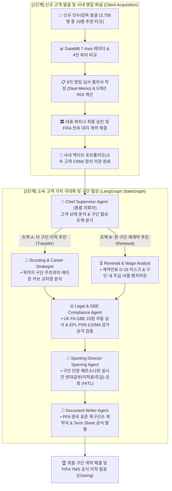

# 🎤 AgencyOS Pro 5분 실전 데모 & 기술 매칭 가이드
**AgencyOS Pro Pitch & Live Demonstration Playbook with Tech-Stack Mapping**

---

- **문서 버전**: v1.0.0
- **작성 일자**: 2026-11-11
- **문서 목적**: 짧은 발표(3~5분)와 라이브 데모 환경에서 **"어떤 화면이 어떤 기술로 동작하는지"**를 한눈에 파악하고, 버벅임 없이 자연스럽게 시연·설명할 수 있는 실전 가이드라인 제공

---

## 1. 한눈에 보는 "기능 ↔ 핵심 기술" 매칭 맵

발표 중 심사위원이나 청중이 *"이 기능은 뒤에서 어떤 기술로 돌아가는 건가요?"*라고 물었을 때 1초 만에 답변할 수 있는 매칭 표입니다.

```
┌────────────────────────────────────────────────────────────────────────────────────────┐
│                        AgencyOS Pro 화면 기능 ↔ 백엔드 기술 매칭 맵                     │
├──────────────────────────┬──────────────────────────┬──────────────────────────────────┤
│ 화면 기능 (UI Feature)   │ 적용 핵심 기술 (Tech)    │ 데이터 원천 및 동작 원리          │
├──────────────────────────┼──────────────────────────┼──────────────────────────────────┤
│ 1. 상단 실시간 속보 바   │ FastAPI REST API +       │ • API-Football v3 (100회 무료)   │
│    (LIVE FEED Ticker)    │ Vertex AI Search Ground  │ • 쿼터 소진 시 Football-Data 자동│
│                          │                          │   폴백 및 데일리 부상자 동기화   │
├──────────────────────────┼──────────────────────────┼──────────────────────────────────┤
│ 2. DataMB 7-Axis 레이더  │ Chart.js Radar Canvas +  │ • 유럽 5대 리그 2,758명 정량 통계 │
│    & 4인 피어 매트릭스   │ Percentile 알고리즘      │ • Opta/FBref 실측 7대 스탯 백분위│
│                          │                          │   (키패스, 크로스, xA, 드리블 등)│
├──────────────────────────┼──────────────────────────┼──────────────────────────────────┤
│ 3. 2D 경기장 전술 재현기 │ HTML5 2D Canvas +        │ • 100x68 정규 피치 좌표 보간 엔진│
│    (FM 스타일 2D Pitch)  │ 하프스페이스 5존 공간분석│ • 4단계 챕터(빌드업-전개-패스-골) │
├──────────────────────────┼──────────────────────────┼──────────────────────────────────┤
│ 4. 구단 단장 AI 협상     │ LangGraph 상태 머신 +    │ • Sporting Director 페르소나 LLM │
│    스파링 (Sparring Desk)│ Agent Workflow           │ • 이적료/주급 반대급부 자동 조율 │
│                          │                          │ • 6각 영입 타당성 다각도 심사    │
├──────────────────────────┼──────────────────────────┼──────────────────────────────────┤
│ 5. 구단 PSR & 세무 계산기│ 수식 기반 Financial 엔진 │ • EPL PSR £105M 5년 감가상각 공식│
│    (Finance Calculator)  │                          │ • 5대 리그 Net-to-Gross 세무 역산│
├──────────────────────────┼──────────────────────────┼──────────────────────────────────┤
│ 6. 법률 규정 검색 & 감사 │ sqlite-vec (로컬 벡터DB) │ • FIFA 공식 규정집 7종 712 청크  │
│    (Legal Compliance RAG)│ + 코사인 유사도 검색     │ • UK FA GBE 15점 자동 판정 트리  │
├──────────────────────────┼──────────────────────────┼──────────────────────────────────┤
│ 7. 딜 메모 & PFA 계약서  │ Markdown / CSS Print +   │ • 영국 PFA 표준 선수 대리 계약서 │
│    (Document Writer)     │ Form Auto-Prefill        │ • 서명 가능한 공식 서식 즉시 출력│
└──────────────────────────┴──────────────────────────┴──────────────────────────────────┘
```

---

## 2. 전체 시스템 아키텍처 요약 (어떻게 돌아가는가?)

AgencyOS Pro는 **[1단계: 신규 고객 발굴 및 사내 전속 계약]**과 **[2단계: 소속 고객의 구단 이적·재계약 협상]**이라는 **축구 에이전시의 2대 풀 라이프사이클(Full Lifecycle)**을 완벽히 유기적으로 연결한 시스템입니다.



> [!IMPORTANT]
> **에이전시의 2종류 계약서 완전 정복 (발표 핵심 포인트)**:  
> 1. **에이전시 ↔ 선수 간 계약 (Phase 1)**:  
>    - *"네가 우리 에이전시의 소속 고객이 된다."* $\rightarrow$ **FIFA Representation Agreement (사내 전속 대리 계약서)**
> 2. **에이전시 ↔ 프로 구단 간 계약 (Phase 2)**:  
>    - *"우리 소속 선수를 이적료 €80M, 주급 £200k에 영입해라."* $\rightarrow$ **PFA Standard Player Contract (프로 구단 입단/이적 계약서)**
> 
> 즉, **1단계에서 유망주를 발굴해 우리 회사 고객으로 도장을 찍고(Phase 1), 2단계에서 그 선수를 데리고 구단 단장과 피 튀기는 이적/재계약 협상을 벌이는(Phase 2)** 완전무결한 에이전시 운영 사이클입니다.

---

## 3. 실전 5분 라이브 데모 대본 (Time-Stamped Script)

> [!TIP]
> **시연 권장 타깃**: **`Lamine Yamal (라민 야말)`** 또는 **`Pedri (페드리)`**를 선택하고 시연하면 스탯, 시세, 전술 데이터가 가장 화려하게 표현됩니다.

---

### [0:00 ~ 0:30] 오프닝: 문제 제기 및 한 줄 소개 (Hook & Pitch)

* **행동**: 브라우저 메인 대시보드([`http://localhost:8000`](http://localhost:8000))를 띄우고 서두 시작.
* **대본**:  
  > *"안녕하십니까. 프로 축구 에이전시는 수백억 원의 이적료가 오가는 거대한 비즈니스지만, 지금까지의 에이전트들은 감이나 인맥, 파편화된 뉴스에 의존해 일해 왔습니다.  
  > 저희 **AgencyOS Pro**는 정량 데이터 분석부터 구단 단장과의 AI 가상 협상, FIFA 법률 및 영국 워크퍼밋 감사, 공식 PFA 계약서 발행까지 전 과정을 원스톱으로 처리하는 **글로벌 축구 에이전시 전용 멀티 에이전트 OS**입니다. 지금부터 5분간 핵심 워크플로우를 직접 보여드리겠습니다."*

---

### [0:30 ~ 1:30] 1단계: 신규 발굴 & 사내 전속 계약 체결 (Client Acquisition)

* **행동**:
  1. 상단 GNB에서 **`[🎯 신규 발굴 & 스카우팅]`** 클릭.
  2. 에이전시 추천 타깃 카드 중 **`Lamine Yamal`** 클릭.
  3. **`[⚖️ 동포지션 피어 다각 비교]`** 모달을 열어 정상급 라이벌들과의 7-Axis 스탯 우위 증명.
  4. 모달 닫고 카드 우측 **`[📋 영입 심사·결재 (Deal Memo)]`** 클릭 $\rightarrow$ 6각 심사 점수 및 5개년 기대수익(€18.0M) 확인 후 **`[대표 파트너 최종 승인 및 전속 계약 체결]`** 클릭!
* **보여줄 화면**: 피어 매트릭스 왕관(`👑`) 비교표 $\rightarrow$ Deal Memo 6각 레이더 및 5개년 현금흐름표 $\rightarrow$ 체결 완료 토스트와 함께 **`[🤝 소속 고객 관리]`로 자산이 정식 이관된 화면**.
* **대본**:  
  > *"에이전시의 첫 번째 일은 뛰어난 원석을 발굴해 우리 회사 고객으로 영입하는 것입니다.  
  > 2,758명 중 발굴된 타깃(라민 야말)의 **DataMB 7-Axis 레이더**로 동 포지션 정상급 라이벌들과의 기량 우위를 확인한 뒤, **[영입 심사 Deal Memo]**를 통해 6각 정밀 심사와 향후 5개년 기대 수익(€18M)을 즉시 산출합니다.  
  > 대표 파트너가 승인 버튼을 누르면 **FIFA 공식 대리 계약**이 체결되며, 보시다시피 선수가 우리 에이전시의 **[소속 고객 포트폴리오]**로 정식 등록됩니다."*

---

### [1:30 ~ 2:30] 2단계: 소속 고객 이적 제안 & 구단 단장 AI 협상 스파링 (Club Negotiation)

* **행동**:
  1. 방금 이관된 소속 고객 카드에서 **`[선택한 고객 협상 수립 →]`** 클릭 (또는 상단 GNB **`[⚔️ 이적 제안 & 재무 밸류에이션]`** 클릭).
  2. 좌측 또는 중앙의 **`[단장 협상 AI 스파링 시작]`** 버튼 클릭.
  3. 에이전트의 이적료/주급 제안에 대해 단장 AI가 역제안(Counter-Offer)을 던지는 로그 확인.
* **보여줄 화면**: 유럽 빅클럽 단장의 까다로운 반대급부 채팅과 6각 영입 심사 점수표.
* **대본**:  
  > *"이제 우리 소속이 된 선수를 데리고 프로 구단과의 본격적인 이적(또는 재계약) 협상에 돌입합니다.  
  > 이 화면은 유럽 빅클럽 스포츠 디렉터(Sporting Director) 페르소나를 탑재한 **LangGraph 기반 AI 협상 스파링 엔진**입니다.  
  > 에이전트가 이적료 8,000만 유로와 주급을 제시하면, 단장 AI는 구단의 예산과 주급 체계를 고려해 즉시 반대급부(Counter-offer)를 제시하며 치열한 밀당 공방을 벌입니다. 이를 통해 에이전트는 실전 미팅 전 최적의 협상 타협점을 도출합니다."*

---

### [2:30 ~ 3:30] 3단계: 2D 전술 하이라이트 & 구단 재무 PSR 시뮬레이션 (Tactics & Finance)

* **행동**:
  1. 하단/내부 탭의 **`[2D 전술 재현기]`** 클릭 $\rightarrow$ **`[재생(Play)]`** 버튼 클릭하여 선수 마커들이 움직이는 모습 시연.
  2. 이어서 **`[PSR 재무 계산기]`** 탭 클릭 $\rightarrow$ 이적료 슬라이더를 움직여 감가상각 바 차트 변동 확인.
* **보여줄 화면**: 녹색 2D 경기장 위에서 공과 선수들이 패스를 주고받는 FM 스타일 애니메이션 + 구단 3개년 누적 손실 £105M 안전선 게이지.
* **대본**:  
  > *"협상에서는 전술과 돈, 두 가지가 모두 맞아야 합니다.  
  > 첫째, **[2D 전술 재현기]**는 Football Manager 엔진처럼 100x68 정규 피치 좌표 보간을 통해 우리 선수가 감독의 전술과 하프스페이스 공간에서 어떻게 움직이는지 직관적으로 시뮬레이션합니다.  
  > 둘째, **[PSR 재무 계산기]**는 프리미어리그의 £105M 재정 규정(PSR)에 맞춰 5년 감가상각비와 세후 주급(Net-to-Gross)을 자동 역산하여, 이 영입이 구단에 승점 삭감 징계를 부르지 않는다는 재정적 안전성을 단장에게 증명합니다."*

---

### [3:30 ~ 4:30] 4단계: UK GBE 워크퍼밋 감사 & PFA 공식 계약서 발행 (Legal & Documents)

* **행동**:
  1. 상단 GNB에서 **`[📋 계약 & 컴플라이언스]`** 클릭.
  2. 영국 워크퍼밋(GBE) 점수표(15점 통과 여부 초록 배지) 확인.
  3. 우측 상단 **`[PFA 표준 선수 대리 계약서 발행]`** 또는 **`[Deal Memo 발행]`** 클릭.
* **보여줄 화면**: FIFA FFAR 수수료 상한 검증 결과표 + 영국 프로축구선수협회(PFA) 공식 표준 대리 계약서 전문.
* **대본**:  
  > *"마지막으로 가장 중요한 법률 및 계약 단계입니다.  
  > 영국 프리미어리그 이적에 필수적인 **UK FA GBE 워크퍼밋 15점 채점 요건**을 A매치 출전율과 소속 리그 밴드로 자동 심사합니다. 또한 FIFA 최신 에이전트 규정(FFAR)에 따른 수수료 상한(3~5%)을 로컬 벡터 DB(RAG)로 실시간 감사하여 법적 분쟁을 원천 차단합니다.  
  > 협상이 끝나면 버튼 한 번으로 영국 PFA 공식 표준 대리 계약서와 사내 승인용 딜 메모(Deal Memo)가 자동으로 완성되어 서명만 하면 되는 상태로 즉시 인쇄·출력됩니다."*

---

### [4:30 ~ 5:00] 클로징: 요약 및 질의응답 (Wrap-up)

* **행동**: 다시 메인 대시보드로 돌아오며 청중을 응시.
* **대본**:  
  > *"정리하자면, AgencyOS Pro는 **[정량 스카우팅] $\rightarrow$ [AI 단장 협상] $\rightarrow$ [전술·재무 검증] $\rightarrow$ [FIFA 법률 계약]**까지 축구 에이전시의 4대 핵심 업무를 하나의 유기적인 파이프라인으로 연결한 차세대 에이전시 플랫폼입니다.  
  > 경청해 주셔서 감사합니다. 질문 있으시면 답변드리겠습니다."*

---

## 4. 심사위원 / 청중 예상 질문(Q&A) 방어 치트키

발표 후 나올 수 있는 가장 날카로운 질문 3가지와 모범 답변입니다:

### Q1. "데이터는 어디서 가져왔고, 실시간으로 최신 정보가 업데이트되나요?"
* **모범 답변**:  
  > *"기본 2,758명 선수와 108명 감독의 상세 스탯은 Transfermarkt와 StatsBomb/Opta 오픈 데이터셋을 로컬 SQLite에 캐싱하여 0.05초 만에 초고속 로딩됩니다.  
  > 또한 화면 상단의 **API-Football v3 REST 클라이언트**를 통해 매일 유럽 5대 리그의 실시간 훈련 부상 소식과 최신 이적 루머를 실시간 동기화하고 있으며, 무료 API 100회 한도가 소진될 경우 Football-Data.org로 자동 백업 전환되는 무중단 파이프라인을 갖추고 있습니다."*

### Q2. "LLM 에이전트가 엉뚱한 정보나 환각(Hallucination)으로 잘못된 계약서를 쓰면 어떡합니까?"
* **모범 답변**:  
  > *"그 점을 원천 방지하기 위해 저희는 자유 생성 모델을 쓰지 않았습니다.  
  > FIFA 공식 규정집 7종을 712개의 청크로 분할하여 로컬 벡터 DB(`sqlite-vec`)에 적재한 **RAG(검색 증강 생성) 아키텍처**를 적용했습니다.  
  > 또한 UK FA GBE 15점 심사나 PSR 감가상각비 계산은 AI가 작문하는 것이 아니라 **100% 엄격한 파이썬 수학 및 규칙 기반 결정 트리(Rule-based Decision Tree)**로만 계산되므로 환각이 발생하지 않습니다."*

### Q3. "기존의 FM(Football Manager) 게임이나 트랜스퍼마크트 웹사이트와 무엇이 다른가요?"
* **모범 답변**:  
  > *"FM은 가상의 시뮬레이션 게임이고 트랜스퍼마크트는 단순 정보 조회 웹사이트입니다.  
  > AgencyOS Pro는 **'실제 공인 에이전트(FIFA Licensed Agent)의 현장 실무'**에 철저히 초점이 맞춰져 있습니다. 실제 구단 단장과의 협상 반대급부 조율, 프리미어리그 PSR £105M 재무 장부 감사, 그리고 서명 날인이 가능한 PFA 공식 법률 표준계약서 발행까지 지원한다는 점에서 명확한 B2B 전문 솔루션입니다."*

---

## 5. 데모 시연 전 30초 체크리스트

1. **서버 구동 확인**:
   ```powershell
   # 프로젝트 루트(c:\AI-Native-Agent\sports_agency)에서 실행
   .venv\Scripts\python.exe py/run_server.py
   ```
2. **브라우저 접속**: 크롬에서 [`http://127.0.0.1:8000`](http://127.0.0.1:8000) 접속 (F11 전체화면 권장).
3. **화면 배율**: 100% (와이드 모니터에 최적화된 레이아웃).
4. **추천 선수 미리 선택**: 상단 검색창에서 `Lamine Yamal` 또는 `Pedri`를 한번 클릭해 두면 데모 진행이 훨씬 매끄럽습니다.

