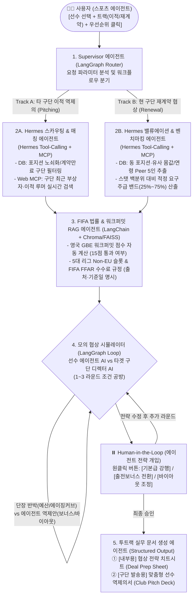

# ⚽ AI 축구 에이전시 전략 데스크 (Football Agency Strategy Desk) — 최종 통합 하이브리드 기획안 (v2.0)

> **문서 목적**: 본 문서는 4대 핵심 목표(**① 100% 실제 데이터 활용, ② 스포츠 에이전시의 진짜 실무 구현, ③ 5대 보유 기술 스택(`RAG`, `LangGraph`, `LangChain`, `MCP`, `Hermes Agent`) 완전 적용, ④ 실제 현업 에이전트가 쓰기 편한 실용적 UX 가치**)를 모두 충족하도록 초안([SPORTS_AGENCY_PLAN.md](file:///c:/AI-Native-Agent/sports_agency/SPORTS_AGENCY_PLAN.md))과 현실성 피드백을 결합·고도화한 최종 설계서입니다.

---

## 1. 핵심 가치 제안: "누가, 왜, 어떻게 이 시스템을 쓰는가?"

### 🎯 타겟 사용자와 해결하는 진짜 실무 페인포인트 (Pain Points)
축구 에이전트의 본질은 구단 단장(Sporting Director)과의 **협상**과 **세일즈(Pitching)**입니다. 하지만 실제 현업 에이전트와 소속 분석가들은 협상장에 들어가기 전 다음과 같은 **반복적인 데이터 수집·문서화 노가다(건당 5~8시간 소요)**에 시달립니다.

| 현업 에이전트의 실제 업무 (As-Is: 수작업 6시간) | 본 시스템이 제공하는 실용적 가치 (To-Be: 원클릭 3분) |
| :--- | :--- |
| **1. 타 구단 역제의(Pitching) 타겟 발굴 및 제안서 작성** 유럽 수십 개 구단의 포지션별 주전 연령·계약만료일·최근 부상자를 일일이 뒤져서, *"우리 선수가 귀 구단의 현재 주전보다 전진 패스는 25% 높고 주급은 절반"*이라는 **구단 맞춤형 세일즈 제안서(Player Pitch Deck)**를 수작업으로 작성 | **[Track A: 이적 타겟 발굴 & 구단 제출용 피치덱 자동 생성]** 선수만 선택하면 DB(스쿼드 노쇠화/계약만료) + 실시간 뉴스(부상/이적설)를 결합해 **최적 구단 Top 3**를 뽑고, 구단 단장에게 즉시 발송 가능한 **구단 맞춤형 1-Page 세일즈 제안서** 생성 |
| **2. 재계약 연봉 인상 근거(벤치마킹) 및 반박 방어 준비** 현 소속팀과 재계약할 때 구단이 *"공격포인트가 줄었다"*며 주급 동결을 주장하면, 동 포지션·유사 몸값 선수 5명의 주급 범위와 세부 기여도(xG, 키패스, 출전 시간)를 비교한 반박 자료를 수작업으로 준비 | **[Track B: 동급 비교군(Peer) 주급 밴드 산출 & 모의 협상 리허설]** 유사 연령·시세·스탯 비교군 5인의 주급 밴드(하위 25%~상위 75%)를 자동 추출하고, **구단 디렉터 AI와의 모의 협상(Sparring)**을 통해 예상 압박 질문과 방어 논리 치트시트 제공 |
| **3. 해외 이적 시 워크퍼밋(GBE) 및 비EU 슬롯 수동 계산** 한국/아시아 선수를 영국(EPL/챔피언십)이나 스페인/이탈리아로 보낼 때 수십 페이지짜리 규정 PDF를 뒤지며 GBE 점수와 Non-EU 쿼터를 수동 계산 | **[규정 & 워크퍼밋 RAG 자동 판독기]** 선수의 A매치 비율·소속 리그 등급·출전 시간을 바탕으로 **영국 GBE 자동 통과(15점) 여부**, **5대 리그 Non-EU 슬롯**, **FIFA 에이전트 수수료 규정(최신 유예 현황 및 기준일 명시)**을 즉시 판독 |

---

## 2. "실제로 쓰는 사람이 편한" 실무자 중심 UX 설계 (Zero-Prompt 지향)

현업 에이전트는 바빠서 채팅창에 프롬프트를 길게 타이핑하지 않습니다. **프롬프트 입력을 최소화한 '대시보드 워크스페이스 UX'**로 설계하여 실사용 가치를 극대화합니다.

1. **Step 1 — 선수 원클릭 선택 (드롭다운 / 로스터 카드)**
   - 에이전시 관리 선수(예: 이강인, 김민재, 황희찬, 설영우, 양민혁, 엄지성 등)를 클릭하면 즉시 우측에 **실제 계약 만료일 · Transfermarkt 시세 · Capology 추정 주급 · 시즌 핵심 스탯 백분위 카드**가 로드됩니다.
2. **Step 2 — 업무 모드 & 협상 우선순위 토글 선택**
   - 🔘 **업무 선택**: `[Track A: 타 구단 이적 역제의(Pitching)]` vs `[Track B: 현 소속팀 재계약 연봉 협상]`
   - 🎚️ **조건 설정 (슬라이더/체크박스)**: 목표 주급 인상률(`+10% ~ +50%`), 최우선 가치(`출전 시간 보장` / `주급 극대화` / `UCL 출전 구단`), 희망 리그 선택 후 **[전략 생성 및 모의 협상 시작]** 버튼 클릭.
3. **Step 3 — 원클릭 모의 협상 개입 (Human-in-the-Loop 액션 버튼)**
   - 에이전트 AI와 구단 단장 AI가 1~2라운드 밀당을 진행한 뒤 멈추면, 사용자가 긴 글을 칠 필요 없이 **전략 선택 버튼**으로 개입합니다:
     - 👉 `[기본급 유지 강행 + 스탯 근거 제시]`
     - 👉 `[기본급 10% 양보 + 출전/공격포인트 보너스 추가 역제안]`
     - 👉 `[바이아웃(Release Clause) 금액 하향 조건으로 구단 안 수용]`
4. **Step 4 — 투트랙(Dual-Output) 실무 문서 즉시 출력**
   - 협상이 끝나면 단순 채팅 로그가 아니라 **실무에서 바로 쓰는 2종의 문서 탭**이 생성됩니다:
     - 📄 **문서 1 (대외비 · 에이전트 내부용): `협상 전략 치트시트 (Deal Prep Sheet)`** — 목표액(Best) / 마지노선(Fallback) / 구단 단장의 예상 공격 포인트 3가지 및 카운터 논리.
     - 📨 **문서 2 (외부 발송용 · 구단 전달용): `구단 맞춤형 선수 역제의서 (Club Pitch Deck)`** — 해당 구단 주전 선수 대비 우리 선수의 전술·가성비 우위 지표 및 GBE 워크퍼밋 통과 증명 요약본.

---

## 3. 5대 보유 기술 스택 100% 활용 매핑 (억지 없는 실무 결합)

요구하신 **5가지 핵심 기술(`RAG`, `LangGraph`, `LangChain`, `MCP`, `Hermes Agent`)**을 모두 빠짐없이, 각 기술이 가장 빛나는 위치에 배치합니다.

| 기술 스택                                                           | 시스템 내 핵심 역할 및 실무적 당위성                                                                                                                                                                                                                                                                |
| :-------------------------------------------------------------- | :----------------------------------------------------------------------------------------------------------------------------------------------------------------------------------------------------------------------------------------------------------------------------------- |
| **1. LangGraph** *(워크플로우 & 상태 제어)*                           | • **조건부 라우팅(`Conditional Edge`)**: Supervisor가 요청을 `Track A(이적 스카우팅)`와 `Track B(재계약 벤치마킹)`로 분기 • **순환 루프(`Cycle`)**: `선수 에이전트 AI ↔ 구단 디렉터 AI` 간의 다회차 모의 협상(Sparring Loop) 구현 • **Human-in-the-Loop (`interrupt`)**: 모의 협상 중간에 실제 사람 에이전트가 전략 방향(강행/타협/옵션조정)을 결정                |
| **2. Hermes Agent** *(NousResearch Tool-Calling & 정량 분석 전담)* | • 복잡한 다단계 도구 호출(Multi-step Tool Calling)과 엄격한 JSON 스키마 출력에 특화된 **Hermes 에이전트 아키텍처(또는 Hermes-3 기반 Function-Calling 프롬프트/런타임)**를 **'데이터 & 밸류에이션 분석 에이전트(Track A/B Analyst)'** 엔진으로 탑재 • 선수 스탯 조회 → 비교군 5인 필터링 → 주급 사분위수(25%~75%) 밴드 계산 → 구단 포지션 노쇠화 매칭까지 자율적으로 도구를 연쇄 호출해 정량 테이블 생성 |
| **3. MCP (`FastMCP`)** *(데이터 & 외부 검색 표준화)*                   | • 에이전트 코드와 데이터 소스를 분리하여 표준 MCP 서버(`football_mcp_server.py`)로 구축 • **정적 실데이터 조회 Tool**: 로컬 SQLite(`agency_desk.db`)에 적재된 Transfermarkt + FBref + Capology 데이터 조회 • **실시간 동향 검색 Tool**: `Tavily API` / `SerpAPI`를 통해 구단 주전 부상 소식·감독 전술 인터뷰 실시간 수집                                |
| **4. RAG (ChromaDB / FAISS)** *(규정 · 워크퍼밋 · 수수료 검증)*         | • **영국 FA GBE(워크퍼밋) 점수표 PDF**, **유럽 5대 리그 Non-EU 외국인 규정**, **FIFA 에이전트 규정(FFAR) 및 유예 공문** 인덱싱 • 에이전트 수수료 상한(FFAR 15조)처럼 국가별·시점별로 유예/변동되는 규정을 하드코딩하지 않고, 반드시 **`[출처 문서명 + 조항 + 기준일]`**을 명시하여 법적 정확성 확보                                                                             |
| **5. LangChain** *(파이프라인 & 구조화 출력)*                          | • 규정 문서 로더/청킹 파이프라인 구성 및 에이전트 최종 산출물(`DealPrepSheet`, `ClubPitchDeck` Pydantic 스키마)의 `with_structured_output` 강제 변환                                                                                                                                                                  |

---

## 4. 실제 데이터(Real Data) 파이프라인 및 한계 돌파 설계

"가짜 더미 데이터"가 아닌 **실제 축구계 표준 데이터 소스 4종**을 조합하되, 데이터의 현실적 한계를 실무 논리로 보완합니다.

| 데이터 영역 | 실제 데이터 출처 | 데이터 한계점 | 실무적 돌파 전략 (기획 반영) |
| :--- | :--- | :--- | :--- |
| **시세 · 계약만료 · 포지션** | **Transfermarkt** 공개 데이터셋 | 실시간 웹 크롤링 시 차단 위험 | 정제된 Transfermarkt 오픈 CSV/Parquet 데이터를 로컬 **SQLite (`agency_desk.db`)**에 적재하여 0.01초 내 즉시 조회 |
| **시즌 세부 스탯** | **FBref / StatsBomb** (`soccerdata`) | 단일 지표만으로는 선수 가치 설명 부족 | 90분당 득점/도움뿐만 아니라 **xG, xA, 전진 패스, 기회 창출, 출전 시간 비율, 동 포지션 내 상위 백분위(%)**를 함께 적재 |
| **주급 · 연봉** | **Capology** 스냅샷 + 웹 검색 보완 | 구단 공식 발표가 아닌 **추정치(Estimated)** 포함 | DB에 `is_estimated=True` 플래그를 명시하고, 단일 금액 대신 **동급 비교군(Peer 5인)의 주급 밴드(Min ~ Median ~ Max)**로 제시하여 협상 근거로 활용 |
| **구단 전술 수요 · 부상 공백** | **DB 스쿼드 연령/계약만료** + **`Tavily` 실시간 검색** | 정적 DB만으로는 '이번 주 주전 부상'을 모름 | 1차로 DB에서 **주전이 30세 이상이거나 계약 만료 1년 이하인 구단**을 필터링한 뒤, 2차로 **MCP 실시간 뉴스 검색**으로 최근 부상·영입설을 교차 검증 |
| **규정 · 워크퍼밋 · 수수료** | **FA GBE 규정집, 5대 리그 규정, FIFA FFAR PDF** | FIFA 수수료 상한(FFAR 15조)은 EU 재판소 판결 및 영국 FA 등에서 일부 효력 정지 상태 | RAG 문서에 **FIFA 원안(3~5% 상한)**과 **유럽/영국 유예 현황(2024~2026 기준)**을 모두 넣고, 답변 시 **적용 국가와 기준일**을 함께 브리핑 |

---

## 5. 통합 멀티 에이전트 아키텍처 (5개 전문 모듈 구성)

---

## 6. SQLite DB 스키마 및 MCP 도구 명세

### 🗄️ 1. 로컬 실데이터 DB (`data/agency_desk.db`) — 3개 핵심 테이블
1. **`players` (관리 선수 및 비교군 마스터 테이블)**
   - `player_id`, `name`, `name_ko`, `current_club`, `league`, `position`, `age`, `nationality`, `is_eu_citizen` (Non-EU 판별용)
   - `contract_expires` (계약 만료일), `market_value_eur` (Transfermarkt 시세), `weekly_wage_eur` (Capology 주급), `is_wage_estimated` (추정치 여부)
   - `intl_match_pct` (최근 1~2년 A매치 출전 비율 % — 영국 GBE 계산용), `continental_minutes_pct` (UCL/UEL/ACL 출전 비율 %)
2. **`player_stats` (FBref 기반 시즌 퍼포먼스 테이블)**
   - `player_id`, `season`, `minutes_played`, `appearances`, `goals_per90`, `assists_per90`, `xg_per90`, `xa_per90`, `key_passes_per90`, `progressive_actions_per90`, `pos_percentile` (동 포지션 상위 %)
3. **`club_squad_needs` (유럽 타겟 구단 포지션 스쿼드 현황 테이블)**
   - `club_name`, `league`, `league_band` (GBE Band 1~6 등급), `position`, `current_starter`, `starter_age`, `starter_contract_expires`, `starter_weekly_wage_eur`, `wage_budget_tier` (`High`/`Mid`/`Low`), `non_eu_slots_free` (잔여 비EU 슬롯 수), `tactical_style` (점유율/하이프레싱/역습 등)

### 🔌 2. FastMCP 서버 (`mcp_server/football_mcp_server.py`) — 5개 핵심 Tool
1. `get_player_complete_data(player_name: str)`: 선수 기본 계약 정보 + 세부 스탯 + GBE 계산용 기초 지표를 통합 반환.
2. `find_matching_clubs_for_transfer(position: str, max_fee_eur: float, player_wage_eur: float)`: **[Track A]** 주전 노쇠화(29세+) 또는 계약 만료 임박(1년 이하)이면서 선수 목표 주급을 감당할 수 있는 구단 Top 5 후보 추출.
3. `get_peer_group_wage_band(position: str, age: int, market_value_eur: float)`: **[Track B]** 동 포지션·유사 연령(±2세)·유사 시세 선수 5명의 주급 최솟값, 중앙값, 최댓값 및 스탯 비교표 반환.
4. `search_live_club_injury_and_rumors(club_name: str, position: str)`: **`Tavily` / `SerpAPI` 실시간 연동** — 해당 구단의 최근 부상 공백 및 영입 타겟 뉴스 검색.
5. `export_agency_documents(player_name: str, deal_prep_md: str, pitch_deck_md: str)`: 최종 생성된 **내부용 협상 치트시트**와 **구단 발송용 피치덱**을 파일(`outputs/`)로 저장.

---

## 7. 이틀(2-Day) 완성형 구현 로드맵

| 일정 | 단계 | 핵심 구현 항목 |
| :--- | :--- | :--- |
| **1일차 오전** | **Phase 1: 실데이터 SQLite DB & FastMCP 서버 구축** | • 코리안리거(이강인, 김민재, 황희찬, 손흥민, 설영우, 양민혁, 엄지성, 배준호 등) 및 유럽 5대 리그 동 포지션 비교군(Peer) 선수 40명 + 주요 타겟 구단 25개 팀의 **실제 Transfermarkt/FBref/Capology 기반 정제 데이터**를 `agency_desk.db`에 적재 • `football_mcp_server.py` 5개 도구 구현 및 테스트 |
| **1일차 오후** | **Phase 2: 규정 RAG + Hermes 분석 에이전트 구현** | • 영국 FA GBE 점수표(A매치·리그 Band·대륙컵 점수), 5대 리그 Non-EU 쿼터, FIFA FFAR 수수료 규정(유예 현황 및 기준일 포함) 문서 작성 및 벡터 DB 인덱싱 • **Hermes 스타일 Tool-Calling 에이전트**로 Track A(구단 매칭) 및 Track B(주급 밴드 벤치마킹) 분석 노드 구현 |
| **2일차 오전** | **Phase 3: LangGraph Supervisor + 모의 협상 루프 + HITL** | • `Supervisor 분기` → `Hermes 데이터 분석` → `규정 RAG` → `에이전트 vs 디렉터 모의 협상 루프(2~3턴)` → `Human-in-the-Loop 개입` → `투트랙 문서 생성` 전체 그래프 연결 |
| **2일차 오후** | **Phase 4: 원클릭 실무 대시보드 UI + 실제 사례 검증(Backtesting)** | • 프롬프트 타이핑 없이 선수 선택·슬라이더 조작·원클릭 개입·투트랙 문서 탭 뷰어를 제공하는 대시보드 구현 • 실제 사례 3건(유망주 영국 진출 GBE 검증, 유럽파 주전 이적 피칭, 핵심 주전 재계약 연봉 협상)으로 백테스팅 및 시연 준비 |
