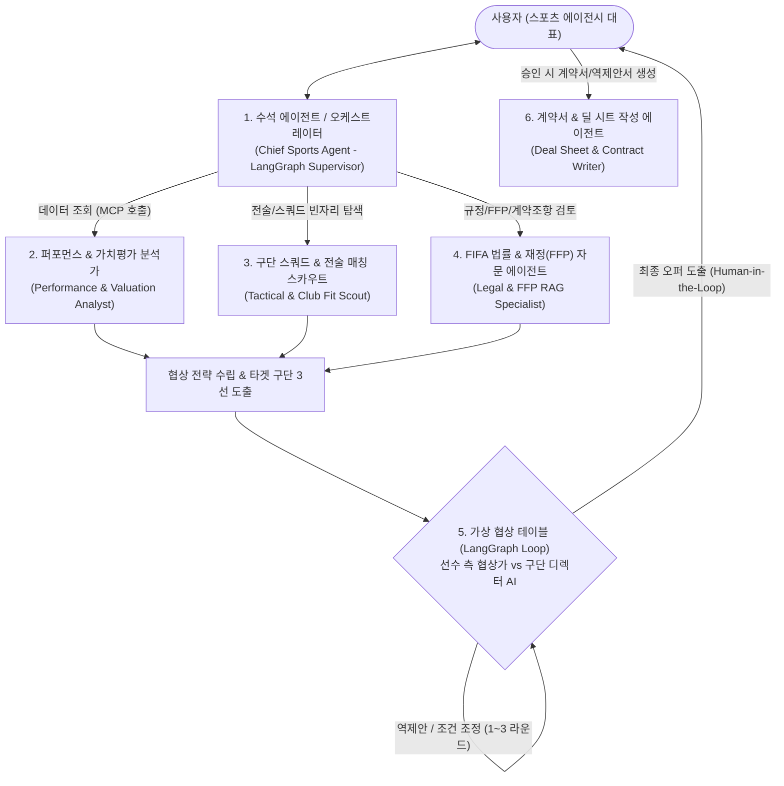

# ⚽ AI 유럽 축구 스포츠 에이전시 (Football Super-Agent) 기획안 및 기술 타당성 보고서

> **문서 목적**: `RAG`, `LangGraph`, `LangChain`, `MCP (Model Context Protocol)`, `Hermes Agent (NousResearch 자율 에이전트/도구호출 프레임워크)`를 결합하여 **유럽 축구 선수의 영입·연봉 재계약 협상·최적 이적 구단 매칭을 수행하는 멀티 에이전트 시스템**의 현실적 구현 가능성(데이터 확보 방안 포함)과 아키텍처를 정의합니다.

---

## 1. 현실성 검증 (Feasibility Study): "실제 데이터를 구할 수 있는가?"

가장 걱정하시는 **"유럽 축구 선수의 세부 스탯, 현재 연봉(주급), 계약 만료일, 구단 재정 상태, 이적시장 루머 데이터를 실제로 구할 수 있는가?"**에 대한 결론부터 말씀드리면 **"매우 높은 수준으로 실제 데이터 확보가 가능하며, 포트폴리오/프로젝트 주제로 최상급"**입니다.

단, 축구 데이터는 단일 공식 무료 API에 모든 것이 다 들어있지 않기 때문에, **공개 데이터셋(정적 DB) + 오픈소스 파이썬 패키지 + 실시간 검색(MCP)**을 조합하는 하이브리드 파이프라인으로 설계해야 막힘없이 구현됩니다.

### 📊 도메인별 실제 데이터 확보처 및 연동 난이도

| 필요한 데이터 항목                                                | 실제 데이터 소스 (무료 / 오픈소스 / API)                                                              | 확보 방법 및 현실적 한계 돌파 전략                                                                                                                                                          |    구현 난이도     |
| :-------------------------------------------------------- | :--------------------------------------------------------------------------------------- | :---------------------------------------------------------------------------------------------------------------------------------------------------------------------------- | :-----------: |
| **1. 선수 몸값(시장가치), 소속팀, 계약 만료일, 에이전시, 부상 이력**              | **Transfermarkt** (`transfermarkt-datasets` GitHub / Kaggle 오픈 데이터셋, `soccerdata` 패키지)   | 실시간 크롤링은 차단될 수 있으나, 매주 자동 업데이트되는 **Transfermarkt 공식 추출 CSV/Parquet 오픈 데이터셋(6만 명+ 선수, 40만 건+ 이적 기록)**을 로컬 SQLite/PostgreSQL에 적재하면 **100% 무료로 즉시 조회 가능**                        |  ⭐ 쉬움 (안정적)   |
| **2. 선수 세부 스탯 (xG, xA, 패스 성공률, 압박, 출전 시간)**               | **FBref / Understat / StatsBomb / SoFIFA** (`soccerdata`, `statsbombpy`, `ScraperFC`)    | 파이썬 `soccerdata` 라이브러리를 통해 유럽 5대 리그(EPL, 라리가, 분데스리가, 세리에A, 리그1) 선수들의 시즌별 고급 스탯(90분당 xG, 전진 패스, 수비 지표)을 Pandas DataFrame으로 즉시 수집 가능                                            |     ⭐⭐ 보통     |
| **3. 선수 실제 주급/연봉 및 구단 샐러리캡(Wage Bill)**                   | **Capology / FBref Wages / FM(풋볼매니저) DB** (`ScraperFC` 또는 Kaggle Capology 스냅샷 + SerpAPI) | 구단이 공식 발표하지 않는 연봉은 **Capology**가 업계 표준입니다. 실시간 스크래핑 대신 **Capology 5대 리그 연봉 스냅샷 CSV + SerpAPI(`site:capology.com "선수명"`) MCP 툴**을 결합하면 정확한 주급(Gross/Net)과 잔여 계약 총액을 가져올 수 있음   |     ⭐⭐ 보통     |
| **4. FIFA 에이전트 규정(FFAR), 리그별 재정적 페어플레이(FFP/PSR), 표준 계약서** | **FIFA 공식 PDF 문서, UEFA FFP 규정집, EPL PSR 규정집**                                            | 공식 사이트에 PDF로100% 공개되어 있음 → **RAG (Vector DB: Chroma / Qdrant / FAISS)**에 임베딩하여 "에이전트 수수료 상한선(연봉의 3~5%)", "미성년자 이적 조항", "바이아웃(Release Clause) 법적 요건" 검색에 활용 (**RAG 활용도 극대화!**) | ⭐ 쉬움 (RAG 최적) |
| **5. 실시간 구단 감독 전술, 주전 부상자 현황, 최신 이적 루머**                  | **SerpAPI / Tavily / BBC Sport / Fabrizio Romano 뉴스 피드**                                 | 예: *"현재 바이에른 뮌헨 윙어 부상 현황"*, *"아스날 이번 여름 타겟 포지션"* 등은 **MCP 웹 검색 서버**를 통해 실시간 뉴스로 보강                                                                                            |     ⭐ 쉬움      |

---

## 2. 왜 이 주제가 보유 기술 스택(RAG, LangGraph, MCP, Hermes)에 완벽한가?

여행 에이전트는 단순히 정보를 모아서 보여주는(Information Aggregation) 성격이 강하지만, **스포츠 에이전시**는 **"이해관계의 충돌(선수 측은 고연봉 원함 vs 구단 측은 FFP 규정 및 예산 방어)"**과 **"정량 데이터(스탯/연봉) + 정성 데이터(규정집 PDF/전술 적합도)"**가 모두 필요하므로, 배우신 모든 기술을 억지스럽지 않게 100% 녹여낼 수 있습니다.

### 🛠️ 기술 스택별 역할 매핑

1. **LangGraph (핵심 워크플로우 & 다중 에이전트 상태 제어)**
   - 단순 일방향 파이프라인이 아니라, **[선수 에이전트 ↔ 상대 구단 디렉터 에이전트] 간의 다회차 연봉/이적료 협상 루프(Negotiation Loop)**와 **Human-in-the-Loop (사용자가 총괄 에이전트로서 최종 오퍼 승인/거절/역제안 지시)**를 상태 그래프(`StateGraph`)로 구현합니다.
2. **RAG (Retrieval-Augmented Generation)**
   - **FIFA 축구 에이전트 규정(FFAR) PDF**, **UEFA 재정적 지속가능성 규정(FSR/FFP)**, **프리미어리그 수익성 및 지속가능성 규칙(PSR)**, **역대 유사 포지션/연령대 이적 사례집**을 벡터 DB에 인덱싱합니다.
   - 계약서 초안 작성 및 협상 시 *"FIFA 규정 제15조에 따라 에이전트 수수료는..."*처럼 정확한 조항을 근거로 제시합니다.
3. **MCP (Model Context Protocol)**
   - 데이터 소스를 표준화된 MCP Server로 분리합니다:
     - `football-db-mcp`: 로컬 SQLite/DuckDB에 담긴 Transfermarkt(몸값/계약만료) + FBref(스탯) + Capology(주급) SQL 조회 도구
     - `market-news-mcp`: SerpAPI / 뉴스 검색을 통해 특정 구단의 최근 부상자 및 이적설 실시간 수집 도구
     - `contract-doc-mcp`: 협상 타결 시 실제 계약서/제안서(Markdown/PDF)를 파일로 생성하는 도구
4. **Hermes Agent (NousResearch Hermes Tool-Calling & Autonomous Agent)**
   - 복잡한 스탯 비교 연산이나 다단계 툴 호출(Function Calling) 및 정형화된 JSON 스키마 출력에 특화된 **Hermes 스타일 에이전트 프롬프트/모델(또는 Hermes Agent 프레임워크)**을 하위 분석가/협상가 에이전트 엔진으로 활용합니다.
5. **LangChain**
   - 문서 로더(PyPDFLoader), 텍스트 스플리터, 임베딩 파이프라인, 프롬프트 템플릿 및 구조화 출력(`with_structured_output`) 구성에 사용합니다.

---

## 3. 멀티 에이전트 아키텍처 설계 (6개 전문 에이전트 구성)

사용자는 **스포츠 에이전시의 대표(Head Agent)**가 되어 *"손흥민(또는 이강인, 김민재, 유망주 양민혁 등)의 연봉 재계약 협상 전략을 짜줘"* 또는 *"이번 여름 이적시장에서 이 선수가 주전으로 뛸 수 있고 연봉을 20% 인상해 줄 수 있는 유럽 구단 3곳을 추천하고 협상 시뮬레이션을 돌려줘"*라고 지시합니다.

### 에이전트별 상세 역할

1. **수석 에이전트 (Chief Orchestrator Agent)**
   - 사용자의 요청이 **[A. 현 소속팀 연봉 재계약]**, **[B. 타 구단 이적 팀 추천 및 매칭]**, **[C. 신규 무소속/타 에이전시 선수 영입 브리핑]** 중 무엇인지 파악하고, 부족한 조건(선수의 최우선 순위: 주전 보장 vs 연봉 극대화 vs 챔피언스리그 출전권 등)을 먼저 역질문합니다.
2. **퍼포먼스 & 시장가치 분석 에이전트 (Performance & Valuation Analyst)**
   - **연동 도구 (MCP)**: `Transfermarkt` + `FBref` + `Capology` 데이터베이스
   - **역할**: 대상 선수의 최근 시즌 세부 스탯(90분당 공격포인트, 동 포지션 유럽 상위 몇 %인지)과 동급 시장가치/유사 스탯을 가진 비교군 선수(Peer Group) 5명의 현재 주급을 비교하여 **"적정 요구 주급(Fair Wage)과 이적료 범위"**를 산출합니다.
3. **구단 스쿼드 & 전술 매칭 에이전트 (Club & Tactical Fit Scout)**
   - **연동 도구 (MCP)**: 구단별 포지션 뎁스(연령, 계약만료 임박 주전 선수 조회) + 실시간 부상/전술 뉴스 검색(`SerpAPI`)
   - **역할**: 유럽 5대 리그 구단 중 ① 해당 포지션 주전 선수가 노쇠화/계약만료 임박이거나 부상 중이고, ② 감독의 전술 스타일(예: 하이프레싱, 점유율 축구)과 선수의 강점 스탯이 맞으며, ③ 주급 지불 여력이 있는 **최적 이적 구단 Top 3 (Plan A / B / C)**를 선정합니다.
4. **FIFA 법률 & FFP 재정 전문가 에이전트 (Legal & FFP RAG Agent)**
   - **연동 도구 (RAG)**: FIFA 에이전트 규정(FFAR), 리그별 샐러리캡/FFP 규정, 표준 선수 계약서 벡터 DB
   - **역할**: 타겟 구단의 재정적 페어플레이(FFP/PSR) 여유분을 체크하고, 계약서에 넣어야 할 특약 조항(**바이아웃 금액, 출전 수당, 챔피언스리그 진출 보너스, 초상권 배분율, 에이전트 수수료 상한**)을 법률적으로 검토합니다.
5. **협상 시뮬레이터 에이전트 (Negotiation Simulator — *킬러 기능!*)**
   - **선수 측 협상 에이전트**와 **상대 구단 스포츠 디렉터(SD) 페르소나 에이전트**가 LangGraph 루프를 돌며 실제로 밀당 협상을 진행합니다.
   - 예:
     - *선수 측*: "동 포지션 상위 10%의 전진 패스 스탯을 기록 중이므로 주급 £150,000와 바이아웃 £60M을 요구합니다."
     - *구단 디렉터 AI*: "우리 구단 주급 체계상 기본급은 £120,000가 한계입니다. 대신 25경기 이상 출전 시 £20,000 보너스와 바이아웃 £75M으로 역제안합니다."
6. **딜 시트 & 계약서 생성 에이전트 (Deal Sheet Generator)**
   - 협상 결과와 3가지 구단 비교 리포트를 바탕으로 실제 에이전시가 구단과 선수에게 제출하는 **공식 텀 시트(Term Sheet) 및 선수 브리핑 자료**를 생성합니다.

---

## 4. 대안 및 확장 가능한 주제 아이디어 (현실적 난이도 조절 옵션)

만약 유럽 축구 전체(수만 명)를 다루는 것이 데이터 정제 측면에서 부담스럽거나, 조금 다른 각도의 매력을 원하신다면 아래 **3가지 변형 주제**도 매우 훌륭합니다.

### 💡 대안 1. "코리안리거 & 아시아 유망주 유럽 진출 전담 에이전시" (가장 추천하는 스코프 축소안)
- **범위**: K리그 유망주 및 유럽파 한국/아시아 선수(약 50~100명) + 유럽 주요 타겟 구단(약 40~50개 팀)으로 핵심 데이터를 깊고 정교하게 구축.
- **장점**:
  - **워크퍼밋(영국 GBE 포인트 계산기 규정 RAG)**, **EU 외 외국인 쿼터(Non-EU 슬롯 규정 RAG — 라리가 3명, 세리에A 연 2명 등)**, **병역 특례/군 문제 고려 타임라인** 등 한국인에게 훨씬 직관적이고 재미있는 법률/규정 RAG 시나리오가 나옵니다!
  - 데이터 검증이 매우 쉬워 발표나 시연 시 설득력이 압도적입니다.

### 💡 대안 2. "구단 프런트(Sporting Director) 머니볼 영입 에이전트" (반대 시점)
- 선수의 에이전트가 아니라, 반대로 **구단 단장(예: 토트넘, 맨유, 브라이튼의 디렉터)** 입장에서 *"우리 팀 주전 스트라이커가 부상당했는데, 이적료 €30M 이하, 주급 €80k 이하이면서 xG가 높은 대체 선수를 발굴해 협상 전략을 짜줘"*를 수행하는 스카우팅 멀티 에이전트.

### 💡 대안 3. "e스포츠(LCK / 글로벌 LoL) 스토브리그 에이전시"
- 축구가 아닌 LoL 프로게이머 스토브리그(연봉 샐러리캡/사치세 규정(SFR) RAG + 선수 지표 + 팀 로스터 빈자리 매칭). 국내 팬들에게 친숙하고 LCK 샐러리캡 규정이 매우 정교해 RAG 활용도가 높습니다.

---

## 5. 추천 구현 로드맵 (Step-by-Step)

이 프로젝트를 실제로 만드신다면 다음 4단계로 진행하는 것이 가장 깔끔합니다:

1. **Phase 1 — 데이터 & MCP 서버 구축 (1~2일)**
   - Kaggle의 `transfermarkt-datasets` + `FBref 스탯/주급 CSV`를 합쳐 **SQLite DB (`football_agency.db`)** 생성
   - 이 DB를 조회하는 **FastMCP 서버 (`football_mcp_server.py`)** 구현
2. **Phase 2 — FIFA 규정 & 유럽 리그 외국인/FFP 규정 RAG 구축 (1일)**
   - FIFA FFAR 규정, 영국 워크퍼밋(GBE) 계산표, 5대 리그 Non-EU 쿼터 규정 문서를 **ChromaDB / FAISS**에 임베딩
3. **Phase 3 — LangGraph 멀티 에이전트 & 협상 시뮬레이션 루프 구현 (2~3일)**
   - `수석 에이전트(인터뷰/라우팅)` → `[스탯분석 | 구단매칭 | 법률RAG]` 병렬 실행 → `선수 에이전트 vs 구단 디렉터 협상 루프` → `최종 텀시트 생성`
4. **Phase 4 — FastAPI + 대시보드 UI 연동 (1~2일)**
   - 선수 레이더 차트(스탯 비교), 구단 매칭 적합도 카드(Plan A/B/C), 실시간 협상 중계 채팅창, 최종 계약서(Term Sheet) 뷰어 구현

