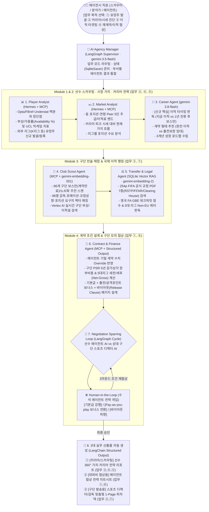

                                        
# ⚽ AI 축구 에이전시 통합 워크스페이스 (Football Agency Enterprise Desk) — 신규 마스터 기획안 (v3.0)
> **기획 목적**: 본 문서는 기존 [`SPORTS_AGENCY_HYBRID_PLAN.md`](file:///c:/Users/DJ/Documents/ai_google/sports_agency/SPORTS_AGENCY_HYBRID_PLAN.md)(v2.0)의 기술 자산을 계승하면서, [`football_agency_guide.md`](file:///c:/Users/DJ/Documents/ai_google/sports_agency/football_agency_guide.md)에 정의된 **축구 에이전시의 핵심 업무 1~5번(① 계약·협상, ② 이적 관리, ③ 선수 발굴·스카우팅, ④ 가치·시장 분석, ⑤ 장기 커리어 관리)** 및 **7~8번(국제 이적 규정·세제/재무 지원)**을 **‘에이전시 내부 실무자(스카우터 · 데이터 분석가 · 수석 에이전트)의 실제 업무 파이프라인’**에 맞춰 유기적으로 재설계한 마스터 기획안입니다. *(코드 미적용 · 순수 기획 설계서)*

---

## 1. 기획 방향성의 핵심 해답: "흩어진 에이전시 업무를 어떻게 나눌 것인가?"

### 💡 왜 기존 v2.0 기획에서는 업무 경계가 모호하게 느껴졌을까?
기존 v2.0([`SPORTS_AGENCY_HYBRID_PLAN.md`](file:///c:/Users/DJ/Documents/ai_google/sports_agency/SPORTS_AGENCY_HYBRID_PLAN.md))은 모든 기능이 **‘협상 시뮬레이션 1회 실행(Track A vs Track B)’**이라는 단일 터널 안에 뭉쳐 있었습니다.
하지만 실제 에이전시([`football_agency_guide.md`](file:///c:/Users/DJ/Documents/ai_google/sports_agency/football_agency_guide.md) 4장 참조)에서는 **스카우터(Scout)**, **데이터/시장 분석가(Data & Market Analyst)**, **이적 매니저(Transfer Manager)**, **수석 에이전트(Football Agent)**가 각기 다른 단계의 업무를 수행합니다.

따라서 가장 명확하고 설득력 있는 기획 방향성은 에이전시 직원이 매일 사용하는 사내 솔루션을 **4대 핵심 부서(4-Stage Lifecycle Modules)**로 명확히 나누고, 이를 **LangGraph 멀티 에이전트**가 분업하도록 설계하는 것입니다.

---

## 2. [`football_agency_guide.md`](file:///c:/Users/DJ/Documents/ai_google/sports_agency/football_agency_guide.md) 필수 업무(1~5번 + 법무/재무) ↔ 4대 모듈 분할 설계

에이전시 전체 업무 중 **AI와 데이터로 자동화·고도화할 수 있는 핵심 영역(Core Scope)**과 **인간 에이전트의 고유 영역(Out of Scope: 실물 대면 미팅, 메디컬 테스트 동행, 스폰서 화보 촬영 등)**을 먼저 명확히 경계 짓고, 핵심 업무 1~5번을 **4개의 실무 데스크(Module 1~4)**로 구조화합니다.

| 모듈 구분 (에이전시 사내 부서) | 포함되는 [`football_agency_guide.md`](file:///c:/Users/DJ/Documents/ai_google/sports_agency/football_agency_guide.md) 필수 업무 | 담당 실무자 페르소나 | 핵심 해결 질문 ([`football_agency_guide.md`](file:///c:/Users/DJ/Documents/ai_google/sports_agency/football_agency_guide.md) 8장) |
| :--- | :--- | :--- | :--- |
| **Module 1. 선수 발굴 & 인텔리전스 데스크** *(Scouting & Player Intelligence)* | **업무 ③ 선수 발굴 및 스카우팅** - 유망주/외부 선수 발굴 및 영입 제안 - 경기 기록·퍼포먼스·장단점 정밀 평가 | **Scout & Data Analyst** (스카우터 / 데이터 분석가) | • *"이 선수의 현재 실력과 객관적 장단점(백분위)은 무엇인가?"* • *"우리 에이전시가 영입(계약)할 만한 유망주인가?"* |
| **Module 2. 시장 가치 & 커리어 전략 데스크** *(Market Valuation & Career Roadmap)* | **업무 ④ 선수 가치 및 시장 분석** **업무 ⑤ 선수 커리어 관리** - 시세 및 동급 비교군(Peer) 주급/이적료 산정 - 출전 기회·부상/가용률·성장 환경 고려 - **이적 적기 판단 (지금 이적 vs 1년 잔류)** | **Market Analyst & Player Manager** (시장 분석가 / 커리어 매니저) | • *"이 선수의 적정 시장 가치와 연봉 밴드는 얼마인가?"* • *"지금 이적하는 것이 좋은가, 다음 시즌까지 기다리는 것이 좋은가?"* • *"완전 이적이 유리한가, 출전 시간 보장형 임대가 유리한가?"* |
| **Module 3. 구단 매칭 & 이적 타겟팅 데스크** *(Club Matchmaking & Transfer Radar)* | **업무 ② 선수 이적 관리** **업무 ⑦ 국제 이적 행정 (GBE/쿼터)** - 이적 가능 구단 탐색 (주전 노쇠화·계약만료·부상) - 구단 감독 전술/포메이션 적합도 매칭 - 영국 GBE 워크퍼밋 및 5대 리그 Non-EU 쿼터 검증 | **Transfer Manager** (이적 매니저) | • *"이 선수를 당장 필요로 하는 구단은 어디인가?"* • *"해당 구단 감독의 전술과 선수의 플레이 스타일이 부합하는가?"* • *"비자(GBE)와 외국인 슬롯(Non-EU)에 결격 사유가 없는가?"* |
| **Module 4. 계약 협상 & 딜 클로징 데스크** *(Contract Negotiation & Deal Desk)* | **업무 ① 선수 계약 및 협상** **업무 ⑧ 법률(FFAR) 및 재정(PSR/세금) 지원** - 연봉·계약기간·출전/득점 보너스·바이아웃 협상 - 구단 PSR 감가상각 및 세전/세후(Net-Gross) 설계 - 구단 디렉터 모의 협상(Sparring) 및 최종 제안서 발송 | **Licensed Football Agent & Legal Specialist** (수석 에이전트 / 법무 담당) | • *"연봉·보너스·바이아웃·수수료를 어떤 구조로 협상해야 구단 CFO와 단장이 수락하는가?"* |

---

## 3. 전체 아키텍처 및 에이전트 분업 구조 (Multi-Agent Architecture)

[`football_agency_guide.md`](file:///c:/Users/DJ/Documents/ai_google/sports_agency/football_agency_guide.md) 7장의 **6대 전문 에이전트 구조(`Player Analyst`, `Market Analyst`, `Career Agent`, `Club Scout Agent`, `Transfer/Legal Agent`, `Contract Agent`)**와 보유하신 **5대 필수 기술 스택(`LangGraph`, `Hermes Agent`, `MCP`, `RAG`, `LangChain`)**을 1:1로 완벽하게 매핑한 아키텍처입니다.

---

## 4. 기존 v2.0 대비 v3.0에서 새롭게 보강되는 핵심 기획 포인트

[`football_agency_guide.md`](file:///c:/Users/DJ/Documents/ai_google/sports_agency/football_agency_guide.md)의 업무 1~5번과 8장("AI 축구 에이전시가 답해야 할 핵심 질문 6가지")을 완벽히 충족하기 위해 **기존 v2.0에 없던 3가지 실무 의사결정 기능**을 기획에 추가합니다.

### ① 업무 ⑤ (선수 커리어 관리) 완성: `Career Agent`의 "이적 타이밍 & 임대/완전이적 의사결정 매트릭스"
* **배경**: [`football_agency_guide.md`](file:///c:/Users/DJ/Documents/ai_google/sports_agency/football_agency_guide.md) 8장 6번 질문인 **"지금 이적하는 것이 좋은가, 다음 시즌까지 기다리는 것이 좋은가?"**와 1장 ②번의 **"임대 및 완전 이적 조건 협의"**는 기존 v2.0에서 다루지 못했습니다.
* **신규 기획 내용**:
  - 선수의 **나이(Age)**, **현 소속팀 선발 출전 비중(`starter_ratio_pct`)**, **잔여 계약 기간(`contract_expires`)**을 결합해 3가지 커리어 경로 중 최적안을 AI가 정량 판독합니다:
    1. **`즉시 완전 이적 (Immediate Permanent Move)`**: 주전 가동률 70% 이상 + 퍼포먼스 상위 25% 이내 + 잔여 계약 2년 이상일 때 고점 매각/도약 추진.
    2. **`계약 만료 대기 후 보스만 자유계약 (Hold for Bosman Window)`**: 잔여 계약 1년 이하(FIFA RSTP 제18조 3항 적용 대상)일 때, 구단 이적료를 아끼는 대신 선수 본인의 **사이닝 보너스(Signing-on Fee)와 기본급을 극대화**하는 전략 제시.
    3. **`출전 시간 보장형 임대 (Development Loan with Buy-Option)`**: 만 22세 이하 유망주이거나 현 소속팀 선발 비중이 40% 미만일 때, 무리한 빅클럽 벤치행 대신 **의무 출전 비율(예: 리그 60% 이상 출전 시 임대료 감면 조항)**이 포함된 임대 이적 제안.

### ② 업무 ③ (선수 발굴 및 스카우팅) 완성: "2-Way 스카우팅 워크플로우"
* **배경**: 에이전시의 스카우팅은 ① **이미 우리 에이전시 소속인 선수의 장단점 분석**뿐만 아니라, ② **타 에이전시/무소속/외부 리그(K리그 등)의 저평가 유망주를 발굴해 우리 에이전시 고객으로 영입 제안([`football_agency_guide.md`](file:///c:/Users/DJ/Documents/ai_google/sports_agency/football_agency_guide.md) 1장 ③의 마지막 항목)**하는 업무를 포함합니다.
* **신규 기획 내용**:
  - **내부 로스터 스카우팅**: 5대 리그 2,662명 + 감독 96명의 실측 Opta/Understat 백분위 강점·약점 및 내구성 분석.
  - **언더밸류(Undervalued) 유망주 발굴 필터 & 외부 유망주 온보딩**: *"만 23세 이하 + 포지션 상위 20% 퍼포먼스 + 시세 €15M 이하"* 조건으로 시장 저평가 선수를 발굴하고, 에이전시 영입 제안 포인트(커리어 로드맵)를 자동 생성.

### ③ 업무 ①·②·④ 통합 산출물: "3-Doc 실무 문서 패키지"
기존 2종 문서(`협상 치트시트`, `구단 피치덱`)에 더해, 선수 본인이나 에이전시 내부 회의에서 쓰는 **`선수 커리어 & 시장 가치 진단 리포트 (Career & Valuation Report)`**를 추가하여 **업무 1~5번의 모든 결과물이 문서로 남도록** 구성합니다.

---

## 5. 보유 기술 스택 100% 매핑표 (포트폴리오/발표 어필용)

내가 사용해야 하는 모든 기술들이 에이전시 업무 1~5번에 어떻게 빈틈없이 매핑되는지 보여주는 핵심 설계표입니다.

| 보유 기술 스택 | 적용된 에이전시 업무 ([`football_agency_guide.md`](file:///c:/Users/DJ/Documents/ai_google/sports_agency/football_agency_guide.md)) | 구체적 구현 및 작동 역할 |
| :--- | :--- | :--- |
| **1. LangGraph** (`StateGraph`, `SqliteSaver`, `interrupt`) | **전체 업무 총괄 오케스트레이션** (AI Agency Manager + 모의 협상 루프) | • 에이전시 직원의 업무 목적(스카우팅/커리어진단/이적매칭/계약협상)에 따른 조건부 분기 • `선수 에이전트 AI ↔ 구단 스포츠 디렉터 AI` 간의 다회차 협상 루프 및 수석 에이전트 `Human-in-the-Loop` 개입 제어 |
| **2. Hermes Agent** (Tool-Calling & 정량 분석 아키텍처) | **업무 ③ 스카우팅 + 업무 ④ 시장 가치 분석 + 업무 ① 계약/재무 계산** | • 9개 표준 MCP 도구를 연쇄 호출하여 선수 스탯 백분위, Peer 5인 주급 사분위수, 보스만 타겟 구단, 구단 PSR 감가상각 및 세후 연봉을 오차 없이 정량 산출 |
| **3. MCP (`FastMCP`)** (`football_mcp_server.py`) | **업무 ② 이적 구단 탐색 + 업무 ③ 외부 선수 등록 + 업무 ④ 비교군 추출** | • SQLite(`agency_desk.db` 13개 테이블) 정형 쿼리 도구 및 실시간 웹 검색 도구를 표준 MCP 프로토콜로 캡슐화하여 에이전트에게 제공 |
| **4. Dual-Model Vector RAG** (`sqlite-vec` + `gemini-embedding-2` / `001`) | **업무 ② 구단 전술 적합도 매칭 + 업무 ⑦·⑧ 국제 이적 규정/FFAR 법률 검토** | • **법률 RAG (`gemini-embedding-2`)**: 254페이지 FIFA 공식 PDF 7종(`RSTP`, `FFAR`, `Circular 1873`, `Clearing House`) + GBE/Non-EU 규정집(`chunk_size=800, overlap=150, top_k=5`) 검색 • **전술 RAG (`gemini-embedding-001`)**: 선수 플레이스타일과 96명 감독의 포지션별 전술 요구사항 간 시맨틱 유사도 매칭 |
| **5. LangChain & Vertex AI** (`gemini-3.8-flash`, `3.5-flash`, `Grounding`, `Pydantic Structured Output`) | **업무 ①·②·⑤ 최종 의사결정 브리핑 & 실시간 구단 이슈 수집** | • `Vertex AI Google Search Grounding`으로 타겟 구단 주전 부상·감독 인터뷰 실시간 반영 • Pydantic `response_schema`를 통해 협상 타결 금액, 법률 판독문, 실무 마크다운 문서를 100% 정형 JSON으로 생성 |

---

## 6. 에이전시 직원을 위한 화면(UI) 구성 방향성 제안

에이전시 직원이 출근해서 이 웹 서비스를 켰을 때, **"내가 지금 하려는 업무가 어느 탭에 있는지"** 직관적으로 알 수 있도록 **업무 흐름 순(Step-by-Step Desk)**으로 화면 구성을 정의합니다.

1. **[Desk 1] 선수 스카우팅 & 360° 인텔리전스 (업무 ③ 스카우팅)**
   - 5대 리그 선수 2,662명 + 감독 96명 조회 및 **외부 리그 유망주(K리그 등) 직접 등록**.
   - Opta/Understat 기반 포지션 백분위 레이더 차트, 실측 강점/보완점, 시즌 가용률(내구성), UCL/A매치 빅게임 지표 확인.
2. **[Desk 2] 시장 가치 & 커리어 타이밍 진단 (업무 ④ 시장 분석 + 업무 ⑤ 커리어 관리)**
   - 동급 비교군(Peer 5인) 주급 사분위수 밴드(Q25 ~ Median ~ Q75) 및 역대 피크 몸값 추이.
   - **[신규 기획] AI 커리어 타이밍 판독 카드**: `즉시 완전 이적` vs `1년 잔류 후 보스만 자유계약` vs `출전 보장형 임대` 중 선수에게 가장 유리한 시기·형태 추천.
3. **[Desk 3] 구단 전술 매칭 & 보스만 타겟 레이더 (업무 ② 이적 관리 + 업무 ⑦ 국제 행정)**
   - 포지션별 주전 노쇠화(29세+) 및 계약 만료 임박(보스만 룰) 구단 자동 스캔.
   - 타겟 구단 감독(96명)의 선호 포메이션·코칭 능력치·포지션 요구사항 매칭 + 영국 GBE 워크퍼밋 / 5대 리그 Non-EU 쿼터 즉시 판독.
4. **[Desk 4] 계약/세무 시뮬레이터 & 모의 협상 스파링 (업무 ① 계약 협상 + 업무 ⑧ 재무/법률)**
   - 에이전트 기밀 계약 조건(실제 주급·바이아웃·사이닝 보너스·수수료율) 직접 입력 + **구단 연간 PSR 장부 총비용(5년 감가상각) 및 국가별 세후 실수령액(Net Wage)** 실시간 계산.
   - 구단 디렉터 AI와의 2라운드 모의 협상(HITL 원클릭 전략 개입) 및 **최종 실무 문서(협상 치트시트 / 구단 발송용 1-Page 피치덱 / 커리어 전략서) PDF 출력**.
